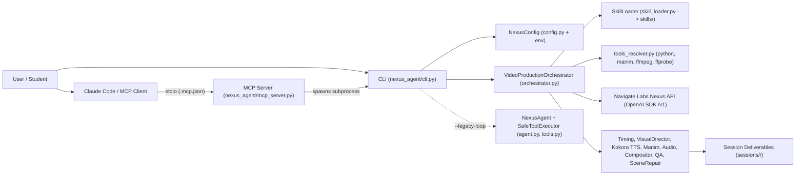
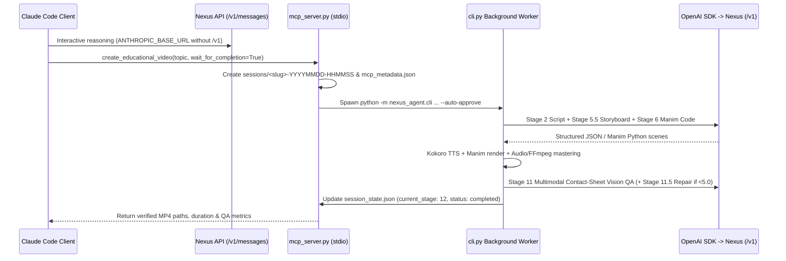
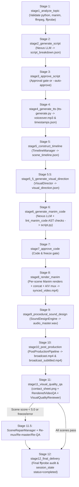

# System Architecture

The Nexus Manim Video Production Engine converts an educational topic prompt into a synchronized `1920x1080` `30fps` video with neural voiceover, procedural sound design, broadcast loudness mastering (`-14.0 LUFS`), burned-in subtitles, and automated visual QA. For exact CLI flags, MCP parameter schemas, and environment variables, see [`docs/DEVELOPER_REFERENCE.md`](DEVELOPER_REFERENCE.md).

---

## 1. Overall System Architecture



---

## 2. Nexus API and MCP Communication



---

## 3. Complete Educational Video-Generation Lifecycle

Console logs label **11 numbered execution stages** (`[STAGE 1/11]`–`[STAGE 11/11]`) plus inline sub-stages **Stage 5.5** (`TopicAwareVisualDirector` inside Stage 6) and **Stage 11.5** (`SceneRepairManager` inside Stage 11), finishing with `stage12_final_delivery()` (`current_stage: 12` in `session_state.json`):



---

## 4. Audio, Manim Rendering, FFmpeg Composition & QA Pipeline

```mermaid
flowchart LR
    TTS["tts-generate.py (Stage 4 -> voiceover.mp3 & timestamps.json)"] --> TL["TimelineManager & TeachingBeats (sync.py)"]
    TL --> Manim["Manim No-LaTeX Render (Stage 8 -> Scene*.mp4)"]
    Manim --> Concat["FFmpeg concat + Narration Mux -> synced_video.mp4"]

    TL --> AudioMix["SoundDesignEngine + AudioMixer Ducking (Stage 9 -> audio_master.wav)"]
    TTS --> AudioMix
    TTS --> Post["PostProductionPipeline (compositor/pipeline.py)"]
    AudioMix --> Post
    Concat --> Post

    Post --> Loud["TwoPassLoudnorm (-14.0 LUFS / -1.0 dBTP)"]
    Loud --> Clean["broadcast.mp4 (H.264/AAC)"]
    TL --> SRT["build_master_srt_from_timeline (subtitles.py -> subtitles.srt)"]
    Clean --> SubBurn["build_composite_filtergraph (MarginV=90 -> broadcast_subtitled.mp4)"]
    SRT --> SubBurn

    SubBurn --> QA["RenderedVideoQA (ffprobe + freezedetect) & contact_sheet.py"]
    QA --> Vision["VisualQualityReviewer (Nexus Vision LLM or SKIP_NEXUS_API=1)"]
    Vision -->|"Defective scene"| Repair["SceneRepairManager (Single-scene fix + Stage 8/10 rebuild)"]
```



---

## 5. Module & Skills Responsibilities

### Core Package (`nexus_agent/`)
- **Entrypoints & Runtime:** `cli.py` (structured CLI runner) and `mcp_server.py` (5-tool stdio MCP server) run `orchestrator.py`; `--legacy-loop` routes through `agent.py` (`NexusAgent`) and `tools.py` (`SafeToolExecutor` path sandboxing and secret masking).
- **Planning & Safety Gates:** `skill_loader.py` injects `SKILL.md` instructions per stage; `visual_director.py` validates storyboard alignment (`validate_visual_plan()`); `lint_manim_code()` enforces AST syntax, forbids `MathTex`/`Tex` when LaTeX is absent, and caps `self.wait(...)` at `<= 1.5s`.
- **Timing, Audio & Post-Production:** `sync.py` builds narration-first `TeachingBeat` timelines; `audio/` (`dsp.py`, `sfx_synth.py`, `mixer.py`, `engine.py`) synthesizes procedural SFX with speech ducking; `compositor/` (`boundary_fades.py`, `loudnorm.py`, `subtitles.py`, `overlays.py`, `pipeline.py`) masters clean and subtitled `1080p` deliverables.
- **Verification & Self-Healing:** `contact_sheet.py`, `rendered_video_qa.py`, `vision_review.py`, and `scene_repair.py` inspect rendered frames, isolate failing scene classes, and re-master without regenerating healthy scenes. (`run_acceptance_test.py` drives full live MCP acceptance tests.)

### Skill Architecture (`skills/`)
`SkillLoader` (`nexus_agent/skill_loader.py`) indexes `SKILL.md` and `references/` dynamically via `STAGE_SKILL_MAPPING`:
- `visual_planning` / `visual_direction` -> `motion-design`, `manim-video`
- `script_generation` -> `manim-video`, `motion-design`
- `manim_generation` -> `manim-skill`, `manim-video`
- `audio` / `sound_design` -> `sound-design`
- `post_production` / `review_loop` / `qa` -> `review-loop`, `video-use`

Supporting helper scripts inside `skills/` include [`skills/manim-skill/tools/video_viewer.py`](../skills/manim-skill/tools/video_viewer.py) (used by `launch_video_viewer`), `tts-generate.py`, `lint-subtitles.py`, `skills/nexus-video-production/SKILL.md` (with `references/`), and `skills/video-use/helpers/`.

---

## 6. Practical End-to-End Execution Example

Trace of running a 90-second video from Windows PowerShell:

```powershell
.\.venv\Scripts\Activate.ps1
python -m nexus_agent.cli "Explain Gradient Descent to beginners" --scenes 5 --target-duration 90 --auto-approve
```

1. **Entry & Workspace (`cli.py:main` -> `stage1_analyze_topic`):**
   - `slugify()` truncates to 32 characters and produces `explain-gradient-descent-to-begi`. `load_nexus_config()` sets session directory `sessions/explain-gradient-descent-to-begi/` (unless `MANIM_SKILL_HOME` or `--session-dir` overrides it).
   - `validate_required_executables()` locates `.venv\Scripts\python.exe`, `.venv\Scripts\manim.exe`, `ffmpeg.exe`, `ffprobe.exe`, and detects LaTeX availability.
2. **Script & Kokoro Narration (`stage2_generate_script` -> `stage4_generate_tts`):**
   - `OpenAI` client sends prompt + `manim-video`/`motion-design` skill guidance to `NEXUS_MODEL`, writing `script_breakdown.json`.
   - `stage3_approve_script()` auto-approves because `--auto-approve` is set.
   - Stage 4 writes `narration.txt` (`SubtitleSpec` list) and invokes [`skills/manim-skill/tools/tts-generate.py`](../skills/manim-skill/tools/tts-generate.py) (Kokoro `KPipeline`), producing `voiceover.mp3` and `timestamps.json`.
3. **Timeline, Storyboard & Code (`stage5_construct_timeline` -> `stage6_generate_manim_code`):**
   - `TimelineManager.build_timeline()` runs `decompose_narration_into_beats()` and writes `scene_timeline.json`.
   - `TopicAwareVisualDirector.generate_visual_plan()` (`stage5_5`) produces `visual_direction.json`.
   - `stage6_generate_manim_code()` generates 5 `Scene` subclasses using pure Pango `Text(...)` and geometry, verifies them with `lint_manim_code()`, repairs any syntax/LaTeX/freeze issues via `_repair_code_with_llm()`, and saves `script.py`.
4. **Manim Render & FFmpeg Muxing (`stage8_render_manim`):**
   - Invokes `[manim_bin, "-qh", "script.py", <SceneClass>]` sequentially for all 5 scenes inside `sessions/explain-gradient-descent-to-begi/media/`, writes `concat.txt`, concatenates `silent_video.mp4`, and muxes `voiceover.mp3` via `TimelineManager.mux_audio_video()` -> `synced_video.mp4`.
5. **Procedural SFX & Broadcast Mastering (`stage9_procedural_sound_design` -> `stage10_post_production`):**
   - `SoundDesignEngine.generate_sound_score()` mixes speech-ducked procedural SFX with `voiceover.mp3` and exports `audio_master.wav` via `sfx_engine.mixer.export_wav()`.
   - `PostProductionPipeline.produce_broadcast_master()` validates/reuses `audio_master.wav`, applies `TwoPassLoudnorm` (`-14.0 LUFS`, `-1.0 dBTP`), outputs clean `broadcast.mp4`, calls `build_master_srt_from_timeline()` (`subtitles.srt`), and burns `MarginV=90` captions -> `broadcast_subtitled.mp4`.
6. **QA, Delivery & Output Verification (`stage11_visual_quality_qa` -> `stage12_final_delivery`):**
   - `generate_contact_sheet()` creates `contact_sheet.png`; `RenderedVideoQA` + `VisualQualityReviewer` generate `RENDERED_VIDEO_QA_REPORT.md` & `rendered_video_qa.json`. Any scene scoring `< 5.0` or containing freezes triggers Stage `11.5` `SceneRepairManager.repair_single_scene()`.
   - Verify the final deliverable directly with `ffprobe`:
     ```powershell
     ffprobe -v error -show_entries format=duration:stream=codec_type,codec_name,width,height -of json sessions/explain-gradient-descent-to-begi/broadcast_subtitled.mp4
     ```
